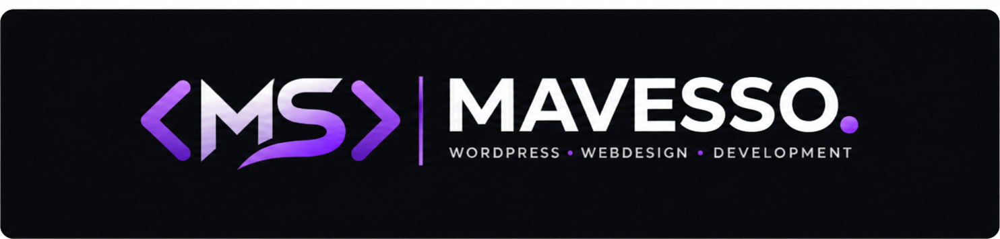

  

# MAVESSO.

### WordPress · Webdesign · Development

**Moderne Webseiten. Klare Designs. Digitale Lösungen.**

Willkommen bei **MAVESSO**!

Ich entwickle moderne, responsive Webseiten mit einem Fokus auf ansprechendes Design, Benutzerfreundlichkeit und saubere technische Umsetzung.

## Leistungen & Technologien

- WordPress & Elementor
- WooCommerce
- HTML5 & CSS3
- JavaScript
- Responsive Webdesign
- Individuelle Webseiten und Landingpages

## Ausgewählte Projekte

### 🏨 Hotel Aurelia

Moderne Hotel-Webseite mit Zimmerübersicht, Wellness-Bereich und responsivem Layout.

**Technologien:** HTML, CSS, JavaScript

[Live-Webseite ansehen](https://mavesso.github.io/hotel-aurelia/)

### 🏡 AUREA Immobilien

Elegante Immobilien-Webseite mit übersichtlichem Design und modernen Gestaltungselementen.

**Technologien:** HTML, CSS, JavaScript

[Live-Webseite ansehen](https://mavesso.github.io/aurea-immobilien/)

### 🛋️ NORDLY Living

Fiktiver Onlineshop für skandinavische Wohnaccessoires mit WordPress, Elementor und WooCommerce.

**Technologien:** WordPress, Elementor, WooCommerce

[Projekt und Screenshots ansehen](https://github.com/mavesso/nordly-living)

---

**MAVESSO – Webdesign mit Persönlichkeit.**

*Portfolio mit ausgewählten Demo- und Webdesign-Projekten.*
